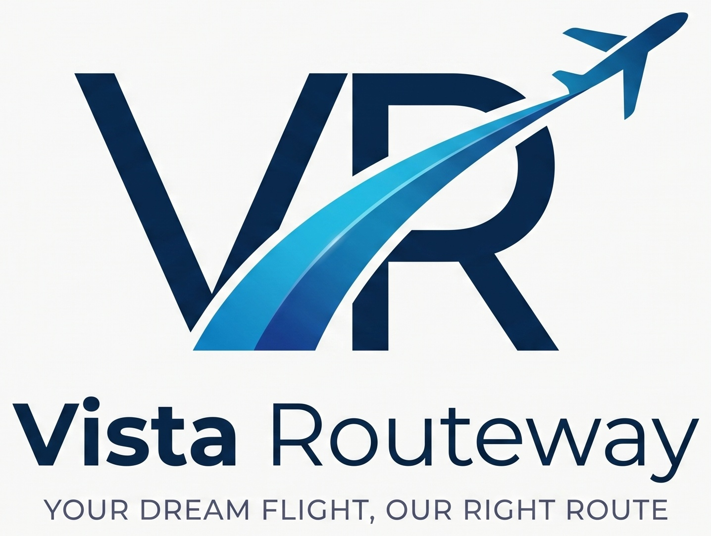

# ✈️ Vista Routeway - Premium Travel Agency & Tour Operator Website

> **Official Website & Digital Portal for Vista Routeway (Dhaka, Bangladesh)**  
> Handcrafted holiday packages, instant worldwide visa assistance, luxury domestic getaways, and VIP Umrah pilgrimages.

---

## 🌟 Key Features

- **Cinematic Ambient Video Hero Banner**: Powered by HTML5 high-efficiency video playback with audio toggle and ambient overlays.
- **Interactive Trip Planner & Quick Search**: Filter by international/domestic destinations, trip styles (Honeymoon, Family, Luxury, Spiritual), and departure windows.
- **Curated Tour Itineraries**: 10 signature tour packages with Day-by-Day breakdowns, high-res galleries, inclusions, exclusions, and instant price calculations in both **BDT (৳)** and **USD ($)**.
- **Instant WhatsApp & Phone Booking Engine**: Pre-fills exact package details directly into WhatsApp for high-converting lead generation.
- **Interactive Dynamic Trip Budget Estimator**: Sliders for travelers, days, and tier selectors (3★, 4★, 5★, Flights, Visa) that recompute total cost in real-time.
- **Cinematic Reel Video Showcase**: Real-time travel reels and full-screen video lightbox player.
- **Full Spectrum Travel Services**:
  - Worldwide Visa Processing (Schengen, USA, UK, Canada, Dubai, Thailand, Malaysia, Singapore, Saudi Arabia)
  - International & Domestic Air Ticketing (IATA/ATAB standard)
  - Luxury Honeymoon & Island Packages (Maldives, Bali, Dubai, Kashmir, Europe)
  - VIP Umrah & Hajj Concierge (Haram-facing 5★ hotels & Haramain train)
  - Domestic Bangladesh Tourism (Cox's Bazar 5★ resorts, Saint Martin coral cruise, Sajek Valley cloud cottages, Sreemangal tea estates)
  - Corporate & MICE Group Tours
- **Verified Client Reviews & FAQ Accordion**: Answering Bangladeshi payment inquiries (bKash, Nagad, Bank, Credit Card EMI) and visa processing timelines.
- **Fully Responsive & Glassmorphic UI**: Optimized across mobile smartphones, tablets, laptops, and ultra-wide desktops.

---

## 🏢 Company Contact Information

- **Brand Name**: Vista Routeway
- **Headquarters**: Dhaka, Bangladesh
- **Phone / Hotline**: `019xxxxxxxx` / `+880 1900-000000`
- **Email**: [vistarouteway@gmail.com](mailto:vistarouteway@gmail.com)
- **WhatsApp**: [+880 1900-000000](https://wa.me/8801900000000)
- **Social Media**:
  - [Facebook Page](https://facebook.com/vistarouteway)
  - [YouTube Channel](https://youtube.com/@vistarouteway)

---

## 🚀 Live Demo & Deployment

- **Live URL**: [https://tanzimsqa.github.io/vista-routeway/](https://tanzimsqa.github.io/vista-routeway/)
- **Repository**: [https://github.com/TanzimSQA/vista-routeway](https://github.com/TanzimSQA/vista-routeway)

---

## 💻 Tech Stack

- **HTML5** (Semantic structure, OpenGraph meta, SEO ready)
- **Tailwind CSS** (Modern utility styling, glassmorphism, responsive grid)
- **Vanilla JavaScript (ES6+)** (Dynamic package rendering, modal engine, real-time budget calculator, video controllers)
- **Google Fonts** (*Plus Jakarta Sans* & *Playfair Display*)
